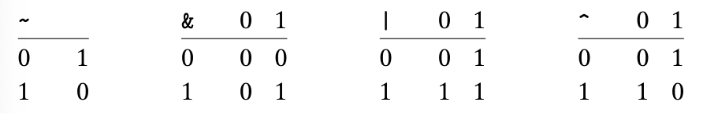
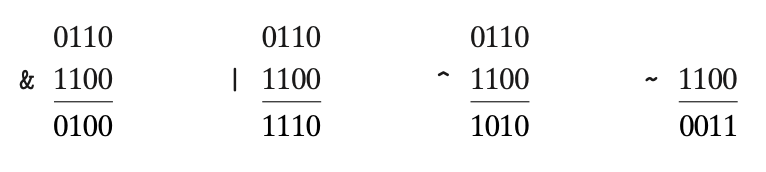

# Arena Notes

Before we can even start thinking about creating a memory arena, we need to cover some basics on bitwise mapping, computer architecture, memory addressing, and memory alignment.

They really made this whole "create an arena" thing sound like less of an endeavor than it really is. So many prerequisites!

# Textbook Chapters to Focus On

Claude's recommendations for navigating [the textbook](https://www.cs.sfu.ca/~ashriram/Courses/CS295/assets/books/CSAPP_2016.pdf):

* **Chapter 2, Representing and Manipulating Information**. Start here. It covers bitwise ops, masking, shifts, and two’s complement, which is exactly the ~(align - 1) material.
* **Section 3.9.3, Data Alignment**. Short, and directly on topic. Chapter 3 (assembly) is useful but not required for the arena. Skim it, and don’t let it become a rabbit hole.
* **Chapter 6, The Memory Hierarchy**. Explains why alignment and locality matter for performance.
* **Section 9.9, Dynamic Memory Allocation**. This is the most relevant part of the book. It walks through building a malloc, including alignment, headers, and fragmentation, and an arena is a simplified version of the same ideas.

# [Chapter 2: Representing and Manipulating Information](https://www.cs.sfu.ca/~ashriram/Courses/CS295/assets/books/CSAPP_2016.pdf)

## Information Storage

Rather than accessing individual bits in memory, most computers use blocks of 8 bits, or *bytes*, as the smallest addressable unit of memory. This is why the `char` type is used to represent the arena buffer in [GingerBill's code](https://www.gingerbill.org/article/2019/02/08/memory-allocation-strategies-002/#heading-2-5), as a `char` is one byte, thus enabling us to navigate the spaces in memory by individual bytes for alignment purposes:

```c
typedef struct Arena Arena;
struct Arena {
	unsigned char *buf;
	size_t         buf_len;
	size_t         prev_offset;
	size_t         curr_offset;
};
```

A machine-level program views memory as a very large array of bytes, referred to as **virtual memory**. Every byte of memory is identified by a unique number, known as its **address**, and the set of all possible addresses is known as the **virtual address space**. As indicated by its name, this virtual address space is just a conceptual image presented to the machine-level program. The actual implementation uses a combination of dynamic random access memory (DRAM), flash memory, disk storage, special hardware, and operating system software to provide the program with what appears to be a monolithic byte array.

Essentially, there's a BUNCH of abstracted-away operations that are used to allocate and manage the storage for different parts of a program. This management is all performed in the virtual address space.

For example, **the value of a pointer in C is the virtual address of the first byte of some block of storage**. The C compiler also associates type information with each pointer, so that it can generate different machine-level code to access the value stored at the location designated by the pointer.

## Data Sizes

Every computer has a **word size, indicating the nominal size of pointer data**. In recent years, there has been a widespread shift from machines with 32-bit word sizes to those with word sizes of 64-bit.

You can see this for yourself with the following code, since the word size on a system will *usually* match the pointer size:

```c
#include <stdio.h>

int main(void) {
    void *ptr;
    printf("A pointer on your system is %zu bytes (%zu bits)\n", sizeof(ptr), sizeof(ptr)*8);
    return 0;
}
// Output: `A pointer on your system is 8 bytes (64 bits)`
```

Most 64-bit machines can also run programs compiled for use on 32-bit machines, a form of backward compatibility. So, for example, when a program `prog.c` is compiled with the directive:

```bash
gcc -m32 prog.c
```

then this program will run correctly on either a 32-bit or a 64-bit machine. On the other hand, a program compiled with the directive:

```bash
gcc -m64 prog.c
```

will only run on a 64-bit machine.

To avoid the vagaries of relying on "typical" sizes and different compiler settings, **ISO C99 introduces a class of data types where the data sizes are fixed regardless of compiler and machine settings**.

Among these are data types `int32_t` and `int64_t`, having exactly 4 and 8 bytes, respectively. **Using fixed-size integer types is the best way for programmers to have close control over data representations**.

**This also ties into GingerBill's use of the `uintptr_t` data type**. [`uintptr_t` is an unsigned integer type (defined in `<stdint.h>`)](https://www.tutorialpedia.org/blog/what-is-the-uintptr-t-data-type/#what-is-uintptr_t) that is capable of storing a data pointer. Its primary purpose is to provide a portable way to store the memory address of a pointer as an integer. It ensures cross-compatibility between different computer architectures since it is explicitly standardized to accommodate any pointer.

This is why we use `uintptr_t` in Bill's [`align_forward` function](https://www.gingerbill.org/article/2019/02/08/memory-allocation-strategies-002/#heading-2-5). We need the pointers to be standardized to ensure the code works on different hardware:

```c
uintptr_t align_forward(uintptr_t ptr, size_t align) {
	uintptr_t p, a, modulo;

	assert(is_power_of_two(align));

	p = ptr;
	a = (uintptr_t)align;
	// Same as (p % a) but faster as 'a' is a power of two
	modulo = p & (a-1);

	if (modulo != 0) {
		// If 'p' address is not aligned, push the address to the
		// next value which is aligned
		p += a - modulo;
	}
	return p;
}
```

Without `uintptr_t`, we risk improperly aligning the memory. If we did not explicitly define this type, the memory alignment would be handled handled differently on different architecture. Remember that the size of a pointer can be different on different machines, thus implicating that memory alignment must also account for this.

Most of the data types encode signed values, unless prefixed by the keyword, `unsigned`. The exception to this is data type `char`. Although most compilers and machines treat these as unsigned data, the C standard does not guarantee this.

Instead, you should use the declaration `signed char` to guarantee a 1-byte signed value. In many contexts, however, the program's behavior is insensitive to whether data type `char` is signed or unsigned. The arena code we've been referring to is an example of one of these exceptions:

```c
typedef struct Arena Arena;
struct Arena {
	unsigned char *buf;
	size_t         buf_len;
	size_t         prev_offset;
	size_t         curr_offset;
};
```

Here, we use an `unsigned char`, since this is the **conventional type for raw bytes**. It signals "untyped memory", not text.

## Introduction to Boolean Algebra

The simplest Boolean algebra is defined over the two-element set {0, 1}. Here are several operations in this algebra:



**Bitwise NOT operator `~`**
* Inverts every binary digit.

**Bitwise AND operator `&`**
* Compares each bit at the same position in the integer and the resultant bit will be set (1) only and only if both the corresponding bits are set (1), otherwise it will be unset (0).

**Bitwise OR Operator `|`**
* Compares each bit at the same position, and the result bit will be set (1) if any of the corresponding bits are set (1).

**Bitwise Bitwise XOR `^`**
* Compares each bit at the same position, and the result bit will be set (1) if the corresponding bits differ, i.e., one should be 1 and the other should be 0.

We can extend the four Boolean operations to also operate on **bit vectors**, strings of zeros and ones of some fixed length *w*. We define the operations over bit vectors according to their applications to the matching elements of the arguments.

As examples, consider the case where *w* = 4 and with arguments *a* = [0110] and *b* = [1100]. The four operations would be as follows:



The practical applications of bitwise operations are covered in [`practical_bitwise_operations.md`](practical_bitwise_operations.md), as these can be incredibly useful for optimizing for BLAZINGLY FAST code. I've deemed these unnecessary to study in-depth for now, since pretty much everything I need is listed in the linked document.

# [Chapter 3, Section 3.9.3 - Data Alignment](https://www.cs.sfu.ca/~ashriram/Courses/CS295/assets/books/CSAPP_2016.pdf)

Many computer systems place restrictions on the allowable addresses for the primitive data types, requiring that the address for some objects must be a multiple of some value *K* (typically 2, 4, or 8). Such **alignment restrictions** simplify the design of the hardware forming the interface between the processor and the memory system.

For example, suppose a processor always fetches 8 bytes from memory with an address that must be a multiple of 8. If we can guarantee that any `double` will be aligned to have its address be a multiple of 8, then the value can be read or written with a single memory operation. Otherwise, we may need to perform two memory accesses, **since the object might be split across two 8-byte memory blocks**.

For this reason, it's generally recommended that data be aligned to improve memory system performance. For instance, Intel's recommended alignment rule says that any object of *K* bytes must have an address that is a multiple of *K*.

Alignment is enforced by making sure that every data type is organized and allocated in such a way that every object within the type satisfies its alignment restrictions. **The compiler places directives in the assembly code indicating the desired alignment for global data**.

And... there ya go. That's where the `align` parameter in the `align_forward` function comes in!

```c
uintptr_t align_forward(uintptr_t ptr, size_t align) {
	uintptr_t p, a, modulo;

	assert(is_power_of_two(align));

	p = ptr;
	a = (uintptr_t)align;
	// Same as (p % a) but faster as 'a' is a power of two
	modulo = p & (a-1);

	if (modulo != 0) {
		// If 'p' address is not aligned, push the address to the
		// next value which is aligned
		p += a - modulo;
	}
	return p;
}
```

So, `align` must be determined somehow by gathering information about the device the code is running on. For example, the assembly-code declaration of the jump table (found god knows where in the textbook - page 271 if your interested) contains the following directive on line 2:

```
.align 8
```

This ensures that the data following it (in this case, the start of the jump table) will start with an address that is a multiple of 8. In the instance of the arena, we were looking for powers of 2.

Since each table entry is 8 bytes long, the successive elements will obey the 8-byte alignment restriction.

(Make sure to find the information on the reference page before continuing)
