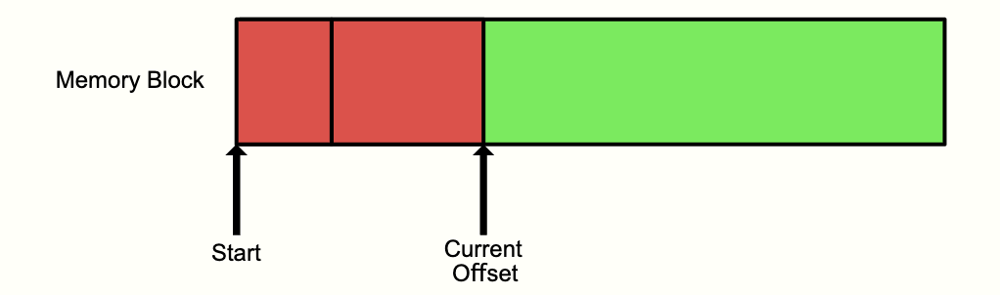
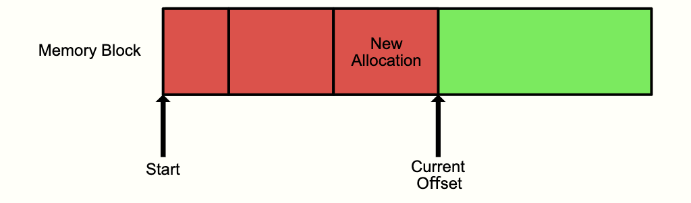

# Understanding [Bill's Arena](https://www.gingerbill.org/article/2019/02/08/memory-allocation-strategies-002/#heading-1-1)

Now that we've covered the basics, let's fully digest [Bill's Arena](https://www.gingerbill.org/article/2019/02/08/memory-allocation-strategies-002/#heading-1-1).

We begin with **linear allocation**. We can move onto the other allocator types if a project's complexity ever calls for it.

# Linear Allocation

As the name suggests, memory is allocated linearly. This goes by other names, such as an **Arena** or **Region-Based Allocator**. Bill refers to it as an *Arena* in his instance.

# Basic Logic

The arena's logic only requires an **offset (or a pointer)** to state the end of the last allocation.



To allocate some memory from the arena, it's as simple as moving the offset **(or pointer)** forward. In Big-O notation, the allocation has a complexity of **O(1)** (constant).



Due to this being the simplest allocator possible, the arena allocator **does not allow the user to free certain blocks of memory**. The memory is usually freed all at once (which is completely fine for your current scope of usage).

When you're a bit more comfortable with these concepts, you can start thinking about freeing blocks of memory in the arena. For now, just get a very confident understanding of the basics.

# Basic Implementation

The simplest arena allocator *could* look something like this:

```c
// Single header needed for `size_t` and `memset`
#include <string.h>

static unsigned char *arena_buffer;
static size_t arena_buffer_length;
static size_t arena_offset;

void *arena_alloc(size_t size) {
    // Check to see if the backing memory has space left
    if (arena_offset+size <= arena_buffer_length) {
        void *ptr = &arena_buffer[arena_offset];
        arena_offset += size;

        // Zero new memory by default
        memset(ptr, 0, size);
        return ptr;
    }

    // Return NULL if the arena is out of memory
    return NULL;
}
```

So, one of the main sources of confusion you had when attempting to jump right in was the `arena_buffer_length`. In reality, this is a pretty simple concept.

The `arena_buffer_length` is simply the size of the arena itself. This confusion likely stemmed from the presentation of `arena_alloc`. `arena_alloc` isn't meant for creating arenas, it's meant to allocate to a pre-existing arena. This is why you were overthinking the variables defined in the above code.

The following lines

```c
if (arena_offset+size <= arena_buffer_length) {
		void *ptr = &arena_buffer[arena_offset];
		arena_offset += size;
```

simply check whether the memory already used (`arena_offset`) plus the memory being requested (`size`) fits within the total size of the arena (`arena_buffer_length`), meaning the sum is less than or equal to it. If it fits, we hand out the memory. If not, we fall through and return NULL.

Moreover, the assignment of `void *ptr = &arena_buffer[arena_offset]` finds where the allocated memory in the arena ends. We then find where the newly allocated memory ends with `arena_offset += size;`.

Then, we use `memset` to ensure that the newly allocated memory isn't filled with garbage values, and instead fills the newly allocated memory with 0s.

Finally, we return `ptr` so we know where memory was last allocated.

**There are two issues with this basic approach:**
* You cannot reuse this procedure for different arenas.
* The pointer returned may not be aligned correctly for the data you need.

The first issue can be easily solved by coupling that global data into a structure and passing that to the procedure `arena_alloc`. As for the second issue, this requires understanding about the basic issues of *unaligned memory* (covered in the [Data Alignment section of 1_arena_notes.md](1_arena_notes.md#chapter-3-section-393---data-alignment))

# Memory Alignment

Modern computer architecture will always read memory at its "word size" (4 bytes on a 32 bit machine, 8 bytes on a 64 bit machine).

If you have an unaligned memory access (on a processor that allows for that), the processor will have to read multiple "words".

This means that the unaligned memory access may be much slower than an aligned memory access (about 2x). As you know, you've covered the basics of this topic already.

# Aligning a Memory Address

On virtually all architectures, the amount of bytes that something must be aligned by must be a power of 2. This means we should create a procedure to assert that the alignment is a power of two:

```c
bool is_power_of_two(uintptr_t x) {
    return (x & (x-1)) == 0;
}
```

To align a memory address to the specified alignment is simple modulo arithmetic. You are looking to find how many bytes forward you need to go in order for the memory address to be a multiple of a specified alignment.

**Note:** More information on binary operations can be found in the [Introduction to Boolean Algebra section of `1_arena_notes.md`](1_arena_notes.md#introduction-to-boolean-algebra) and [practical_bitwise_operations.md](practical_bitwise_operations.md).

```c
uintptr_t align_forward(uintptr_t ptr, size_t align) {
    uintptr_t p, a, modulo;

    assert(is_power_of_two(align));

    p = ptr;
    a = (uintptr_t)align;
    // Same as (p % a) but faster as `a` is a power of two
    modulo = p & (a-1);

    if (modulo != 0) {
        // If `p` address is not aligned, push the address to the
        // next value which is aligned
        p += a - modulo;
    }

    return p;
}
```

This is a perfect time to re-clarify what the `uintptr_t` data type actually is. `uintrptr_t` (as defined in the [Data Sizes section of `1_arena_notes.md`](1_arena_notes.md#data-sizes)) is the an unsigned integer type (defined in `<stdint.h>`) that's capable of storing a data pointer.

"Its primary purpose is to provide a portable way to store the memory address of a pointer as an integer. It ensures cross-compatibility between computer architecture since it is explicitly standardized to accommodate any pointer"

To elaborate a bit further, we're both storing, and returning the pointer as this type so our code works across all (if not, most) computer architectures.

As you hopefully have figured out by now, this function always accepts a pointer. The pointer in question here is `ptr`, which is the last byte of memory that the arena has used.

Again, "You are looking to find how many bytes forward you need to go in order for the memory address to be a multiple of a specified alignment". Without this alignment, you're increasing the number of times you access memory by about 2 (big nono).

In summary, you'd rather take up a few more bytes of memory instead of accessing the memory twice across different word chunks that reference the same information contained within that set of memory.

Sounds inefficient, but consider what happens when you encounter external memory fragmentation when only using `malloc`!

Anyway, now that we know how to align memory, that means we can update our original `arena_alloc` to support alignment properly and store the arena within a structure:

```c
typedef struct Arena Arena;
struct Arena {
    unsigned char *buf; // This is where the arena's memory begins (note the pointer)
    size_t buf_len; // Total memory of the arena
    size_t prev_offset; // Where the arena's previous memory ends
    size_t curr_offset; // Where the arena's current memory begins
};

void *arena_alloc_align(Arena *a, size_t size, size_t align) {
    // Align `curr_offset` forward to the specified alignment
    uintptr_t curr_ptr = (uintptr_t)a->buf + (uintptr_t)a->curr_offset;
    uintptr_t offset = align_forward(curr_ptr, align);
    offset -= (uintptr_t)a->buf; // Change to relative offset

    // Check to see if the backing memory has space left
    if (offset + size <= a->buf_len) {
        void *ptr = &a->buf[offset];
        a->prev_offset = offset;
        a->curr_offset = offset+size;

        // Zero new memory by default
        memset(ptr, 0, size);
        return ptr;
    }

    // Return NULL if the arena is out of memory
    return NULL;
}

#ifndef DEFAULT_ALIGNMENT
#define DEFAULT_ALIGNMENT (2*sizeof(void *))
#endif

void *arena_alloc(Arena *a, size_t size) {
    return arena_alloc_align(a, size, DEFAULT_ALIGNMENT);
}
```

NOW... let's review what all of this means. With the prerequisites fulfilled in our notes, this really isn't as complicated as it initially seemed. The meaning of the `Arena` struct's fields are already taken care of in the code's comments. So let's dive a bit deeper into their usage.

We first want to define where the proposed amount of memory allocation begins (`curr_ptr`) and how much we need to align it (`offset`):

```c
uintptr_t curr_ptr = (uintptr_t)a->buf + (uintptr_t)a->curr_offset;
offset -= (uintptr_t)a->buf; // Change to relative offset
```

Then we check (including the alignment) if that exceeds the memory allocated to the arena. If we're good, set a pointer to the address of the current buffer (again, including alignment). We then update the fields accordingly. Think similar to iterating through a linked list:

```c
// Check to see if the backing memory has space left
if (offset + size <= a->buf_len) {
    void *ptr = &a->buf[offset];
    a->prev_offset = offset;
    a->curr_offset = offset+size;

    // Zero new memory by default
    memset(ptr, 0, size);
    return ptr;
}
```

And *finally* we can find the alignment. This is done (I think) by getting the architecture of your hardware from a void pointer. I have no idea why.

**THERE ARE LIKELY SOME MAJOR MISCONCEPTIONS IN THE ABOVE NOTES. REVISIT THEM**
