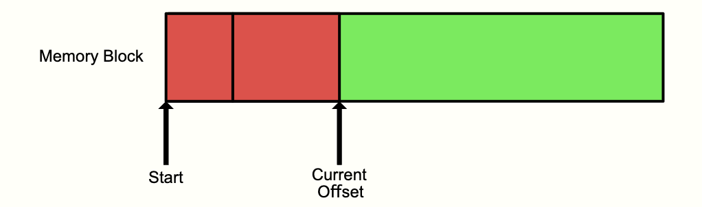

# Understanding [Bill's Arena](https://www.gingerbill.org/article/2019/02/08/memory-allocation-strategies-002/#heading-1-1)

Now that we've covered the basics, let's fully digest [Bill's Arena](https://www.gingerbill.org/article/2019/02/08/memory-allocation-strategies-002/#heading-1-1).

We begin with **linear allocation**. We can move onto the other allocator types if a project's complexity ever calls for it.

# Linear Allocation

As the name suggests, memory is allocated linearly. This goes by other names, such as an **Arena** or **Region-Based Allocator**. Bill refers to it as an *Arena* in his instance.

# Basic Logic

The arena's logic only requires an **offset (or a pointer)** to state the end of the last allocation.

To allocate some memory from the arena, it's as simple as moving the offset **(or pointer)** forward. In Big-O notation, the allocation has a complexity of **O(1)** (constant).

